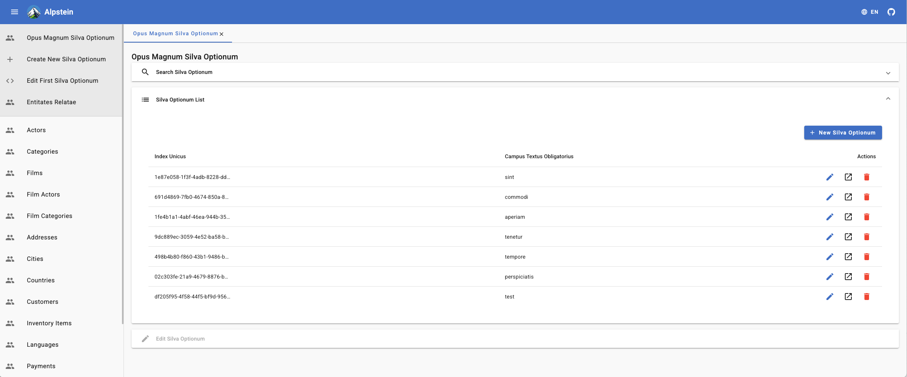
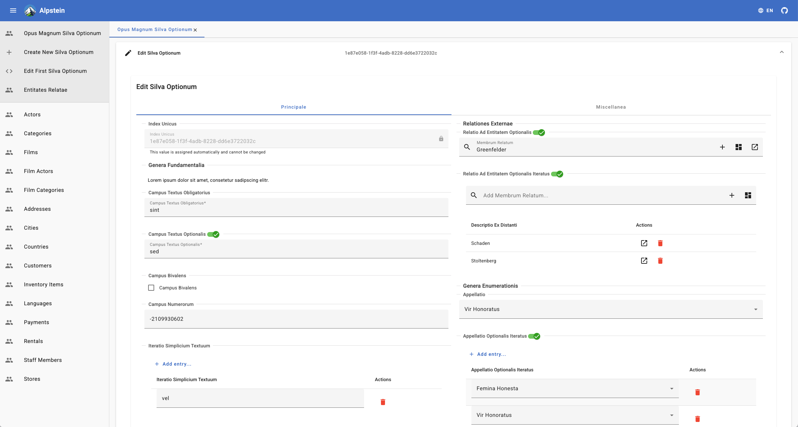

# Alpstein

Alpstein is an example full stack web application (Angular, Spring Boot, PostgreSQL) that
is code-generated from a description of its domain model and a vertical slice template. 
Describe your data once, and you get a complete, working maintenance application for it 
— search, list, create, edit and delete for every entity.





The example domain shipped here is the [sakila](https://www.jooq.org/sakila) DVD-rental
schema. Swap in your own model, and the same application is built for your domain data.

## How it works

Alpstein is built from three building blocks:

1. **The vertical slice** — handwritten, compiling code that implements one artificial example
   entity through every layer: Angular UI, Spring Boot server, database migration and ERD documentation.
2. **The essential data model** — a Kotlin DSL that describes *your* entities: attributes, references,
   enums, UI layout and database mapping. Only the description, nothing else.
3. **The code generation** — treats the vertical slice as a template and replays it once per entity
   of the essential data model.

The generated code is not checked in; `./gradlew build` produces it. See
[building-blocks.md](documentation/building-blocks.md) for the details.

## Run the project

The project contains an Angular client and a Spring Boot server.

If you haven't already, clone the project from GitHub:

```
git clone https://github.com/code-blessing/alpstein.git
```

Build the whole project. This also runs the code generation, without which neither the client
nor the server is complete:

```
./gradlew build
```

Start the backend Spring Boot server:

```
./gradlew :server:app:bootRun
```

Open http://localhost:8081 in your browser to see a welcome page with links to the REST API and
its OpenAPI documentation (Swagger UI).

In a separate terminal/console, start the Angular client:

```
cd client

npm install

npm run start
```

Then open http://localhost:5200 in your browser.

## Where to go next

The documents build on each other in this order:

1. How Alpstein works — the three building blocks: [building-blocks.md](documentation/building-blocks.md)
   - Building block 1, the vertical slice: [building-block-1-the-vertical-slice.md](documentation/building-block-1-the-vertical-slice.md)
   - Building block 2, the essential data model: [building-block-2-the-essential-data-model.md](documentation/building-block-2-the-essential-data-model.md)
   - Building block 3, the code generation: [building-block-3-the-code-generation.md](documentation/building-block-3-the-code-generation.md)
2. Why this approach and what it gives you: [why.md](documentation/why.md)
3. The web application stack (Angular, Spring Boot, PostgreSQL): [web-app-stack.md](documentation/web-app-stack.md)
4. Run the project with a PostgreSQL database: [database.md](documentation/database.md)

## License

The source code is licensed under the MIT license, which you can find in
the [LICENSE](LICENSE) file.
