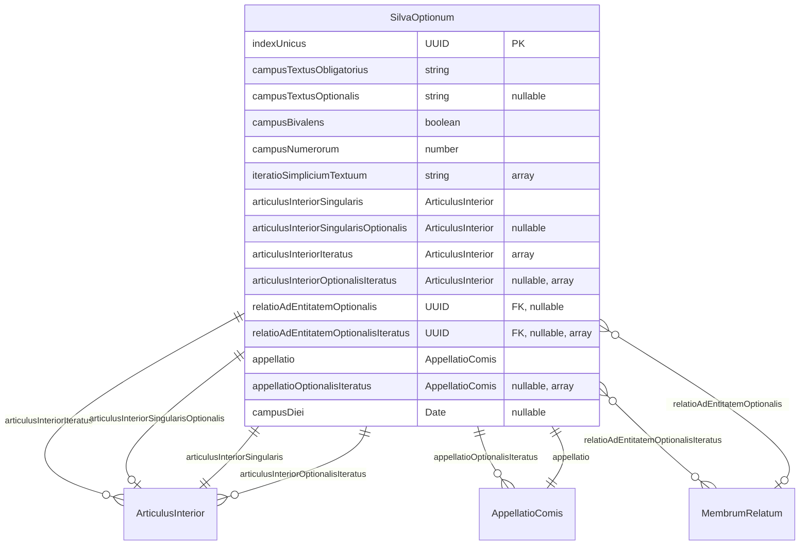
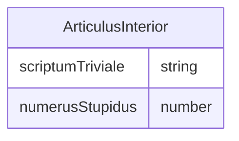
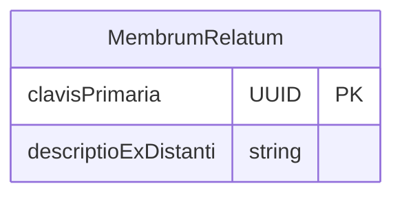
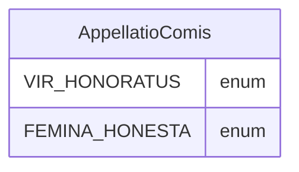

<!-- @tt{{{

    @move-comment-backward
    @template-renderer [
        templateRendererClassName="MarkdownMermaidERDDocumentationRenderer"
        templateRendererPackageName="org.codeblessing.alpstein.codegen.renderer.be"
        templateRendererInterfaceName="BeRenderer"
        templateRendererInterfacePackageName="org.codeblessing.alpstein.codegen.renderer.be"
    ] [
        modelClassName="BeModel"
        modelPackageName="org.codeblessing.alpstein.codegen.renderer.model.be"
        modelName="model"
    ]

    @replace-value-by-value
        [ searchValue="building-block-1-the-vertical-slice.md" replaceByValue="ERD-model.md" ]

    @modify-provided-filepath-by-replacements

    @end-replace-value-by-value

}}}@ -->

<!-- @tt{{{ @ignore-text }}}@ -->
# Building block 1: The vertical slice

The vertical slice is real, fully compiling code that implements a single, artificial
example domain (`SilvaOptionum`, `ArticulusInterior`, `MembrumRelatum`, `AppellatioComis`)
through **every** layer of the application:

* the Angular UI (`client/src/app`): search board, result table, editor form, reference picker,
  delete dialog
* the Spring Boot server (`server:rest`, `server:service`, `server:persistence`,
  `server:example-data`): controllers, business objects, repositories (in-memory and
  PostgreSQL), example-data creators
* the database (`database/postgresql-dsl-schema/db/migration`): the Flyway migration for the
  schema
* the documentation (`documentation`): the Entity Relationship Diagram (ERD)

The entities of the vertical slice are deliberately **artificial** rather than taken from the
DVD-rental [sakila](./database.md) data model (like `Actor` or `Film`), for two reasons:

1. **Every kind of property.** An artificial entity like `SilvaOptionum` combines every kind of
   property the code generation has to support: a mandatory string, an optional string, a date, a boolean,
   a number, a list of strings, an enumeration, an optional list of enumerations, nested entities (single,
   optional, list) and references to other entities (optional and as list). A real entity almost never has
   all these kinds of properties at once, so a real entity used as the template would leave cases uncovered.
2. **No conflict with the essential data model.** A real entity such as `Film` would exist twice:
   written by hand in the vertical slice and generated from the
   [essential data model](building-block-2-the-essential-data-model.md). Leaving it out of the model is
   not an option either, because then other entities (e.g. `Inventory`) could not reference it. An artificial
   entity, on the other hand, is not part of the real-world domain, so it can stay out of the model
   without any loss.

The artificial entities (e.g. `SilvaOptionum`) and their properties (e.g. `indexUnicus`) are named in **Latin**.
This emphasizes that they are artificial and creates a linguistic split between the words of the framework and the
words of the artificial entities: in `SilvaOptionumList`, the framework word `List` is English, while the entity
word `SilvaOptionum` ("a forest of options") is Latin.
That makes it easy to see which part of a name comes from the template and which part is replaced by the
name of a real entity during the code generation.

This file is part of the vertical slice as well: it is the template for the ERD of the real data
model, which the build writes to `documentation/generated-documentation/ERD-model.md`. The HTML
comments at the top of this file and between its sections are the template markers explained in
[building block 3](building-block-3-the-code-generation.md). The rest of this page is the ERD of
the artificial entities.
<!-- @tt{{{ @end-ignore-text }}}@ -->

# Entity Relationship Diagram (ERD)

## Table of Contents

<!-- @tt{{{ @foreach [ iteratorExpression="model.items" loopVariable="item" ] }}}@ -->
<!-- @tt{{{     @replace-value-by-expression
        [ searchValue="SilvaOptionum" replaceByExpression="item.itemName.pascalCase" ]
 }}}@ -->
* [SilvaOptionum](#SilvaOptionum)
<!-- @tt{{{ @end-replace-value-by-expression }}}@ -->
<!-- @tt{{{ @end-foreach }}}@ -->
<!-- @tt{{{ @ignore-text }}}@ -->
* [ArticulusInterior](#ArticulusInterior)
<!-- Comment only to have same line height -->
* [MembrumRelatum](#MembrumRelatum)
<!-- @tt{{{ @end-ignore-text }}}@ -->
* [Enumerations](#Enumerations)

## Items Overview

```mermaid
  erDiagram

%% @tt{{{ @foreach [ iteratorExpression="model.items" loopVariable="item" ] }}}@ 
%%  @tt{{{ @replace-value-by-expression [ searchValue="SilvaOptionum" replaceByExpression="item.itemName.pascalCase" ] }}}@

    SilvaOptionum { }
%%  @tt{{{ @replace-value-by-expression [ searchValue="--o{" replaceByExpression="attribute.mermaidItemRelationship" ] }}}@
%% @tt{{{ @foreach [ iteratorExpression="item.attributesWithItemType" loopVariable="attribute" ] }}}@ 
%%  @tt{{{ @replace-value-by-expression [ searchValue="articulusInteriorIteratus" replaceByExpression="attribute.attributeName.pascalCase" ] }}}@
%%  @tt{{{ @replace-value-by-expression [ searchValue="ArticulusInterior" replaceByExpression="attribute.referencedItem.itemName.pascalCase" ] }}}@
    SilvaOptionum ||--o{ ArticulusInterior : articulusInteriorIteratus
%% @tt{{{ @end-replace-value-by-expression }}}@ 
%% @tt{{{ @end-replace-value-by-expression }}}@ 
%% @tt{{{ @end-foreach }}}@ 
%% @tt{{{ @foreach [ iteratorExpression="item.attributesWithEnumType" loopVariable="attribute" ] }}}@
%%  @tt{{{ @replace-value-by-expression [ searchValue="appellatioOptionalisIteratus" replaceByExpression="attribute.attributeName.pascalCase" ] }}}@
%%  @tt{{{ @replace-value-by-expression [ searchValue="AppellatioComis" replaceByExpression="attribute.enum.enumName.pascalCase" ] }}}@
    SilvaOptionum ||--o{ AppellatioComis : appellatioOptionalisIteratus
%% @tt{{{ @end-replace-value-by-expression }}}@ 
%% @tt{{{ @end-replace-value-by-expression }}}@ 
%% @tt{{{ @end-foreach }}}@ 
%% @tt{{{ @foreach [ iteratorExpression="item.attributesWithItemReference" loopVariable="attribute" ] }}}@
%%  @tt{{{ @replace-value-by-expression [ searchValue="relatioAdEntitatemOptionalisIteratus" replaceByExpression="attribute.attributeName.pascalCase" ] }}}@
%%  @tt{{{ @replace-value-by-expression [ searchValue="MembrumRelatum" replaceByExpression="attribute.referencedItem.itemName.pascalCase" ] }}}@
    SilvaOptionum }o--o{ MembrumRelatum : relatioAdEntitatemOptionalisIteratus
%% @tt{{{ @end-replace-value-by-expression }}}@ 
%% @tt{{{ @end-replace-value-by-expression }}}@ 
%% @tt{{{ @end-foreach }}}@ 
%% @tt{{{ @end-replace-value-by-expression }}}@
%%  @tt{{{ @ignore-text }}}@
    SilvaOptionum ||--o| ArticulusInterior : articulusInteriorSingularisOptionalis
    SilvaOptionum ||--|| ArticulusInterior : articulusInteriorSingularis
    SilvaOptionum ||--o{ ArticulusInterior : articulusInteriorOptionalisIteratus
    SilvaOptionum }o--o| MembrumRelatum : relatioAdEntitatemOptionalis
    SilvaOptionum ||--|| AppellatioComis : appellatio
%% @tt{{{ @end-ignore-text }}}@
%% @tt{{{ @end-replace-value-by-expression }}}@ 


%% @tt{{{ @end-foreach }}}@ 
%%  @tt{{{ @ignore-text }}}@
    ArticulusInterior { }
    MembrumRelatum { }
%% @tt{{{ @end-ignore-text }}}@ 

%% @tt{{{ @foreach [ iteratorExpression="model.enums" loopVariable="enumDefinition" ] }}}@
%% @tt{{{ @replace-value-by-expression [ searchValue="AppellatioComis" replaceByExpression="enumDefinition.enumName.pascalCase" ] }}}@
    AppellatioComis { }
%% @tt{{{ @end-replace-value-by-expression }}}@

%% @tt{{{ @end-foreach }}}@


```

## Items and Enumerations
<!-- @tt{{{ @ignore-text }}}@ -->
The vertical slice consists of the following artificial items and enumerations:
<!-- @tt{{{ @end-ignore-text }}}@ -->
<!-- @tt{{{ @print-text[text="The system consists of the following items and enumerations:"] }}}@ -->

<!-- @tt{{{ @foreach [ iteratorExpression="model.items" loopVariable="item" ] }}}@ -->
<!--  @tt{{{ @replace-value-by-expression [ searchValue="SilvaOptionum" replaceByExpression="item.itemName.pascalCase" ] }}}@ -->

### SilvaOptionum

<!-- @tt{{{ @end-replace-value-by-expression }}}@ -->
<!-- @tt{{{ @end-foreach }}}@ -->

<!--  @tt{{{ @ignore-text }}}@ -->

### ArticulusInterior

### MembrumRelatum

<!--  @tt{{{ @end-ignore-text }}}@ -->

### Enumerations

