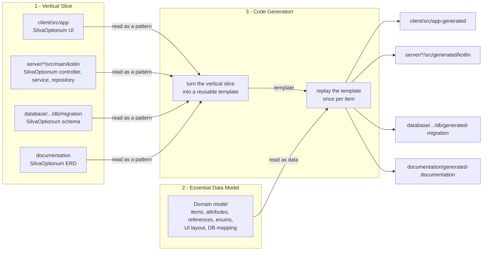

# The three building blocks of Alpstein

Alpstein builds a complete, working web application for **any** data model out of three
building blocks. Each block has exactly one responsibility. Only together do they produce the
finished application as generated code.

`SilvaOptionum` in the diagram is the artificial example entity of the vertical slice; it is
explained in building block 1.

## Building block 1: The vertical slice

The vertical slice is handwritten, compiling code that implements one artificial example domain
(`SilvaOptionum`, named in Latin) through **every** layer: Angular UI, Spring Boot server,
database migration, and ERD documentation. It shows, by example, *how* every entity is
technically implemented.

See [building-block-1-the-vertical-slice.md](building-block-1-the-vertical-slice.md).

## Building block 2: The essential data model

`essential-model-data` describes *what* the concrete project's data is about — its items, attributes,
references, enums, UI layout, and database mapping — written as a Kotlin DSL.
It contains no technical logic, which makes the domain model swappable.

See [building-block-2-the-essential-data-model.md](building-block-2-the-essential-data-model.md).

## Building block 3: The code generation

The code generation connects the first two building blocks. Special comments in the vertical slice mark
the parts that differ from entity to entity, such as names, types and references. This turns the
vertical slice into a reusable template. For each item, the template is then filled in with the
essential data model to write the generated code for every layer.

See [building-block-3-the-code-generation.md](building-block-3-the-code-generation.md).

## The generated code

The generated code is not checked into the repository. `./gradlew build` writes it into the four
`generated` directories shown in the diagram, and `./gradlew clean` removes it again. The only
sources of truth are the handwritten vertical slice and the essential data model.

