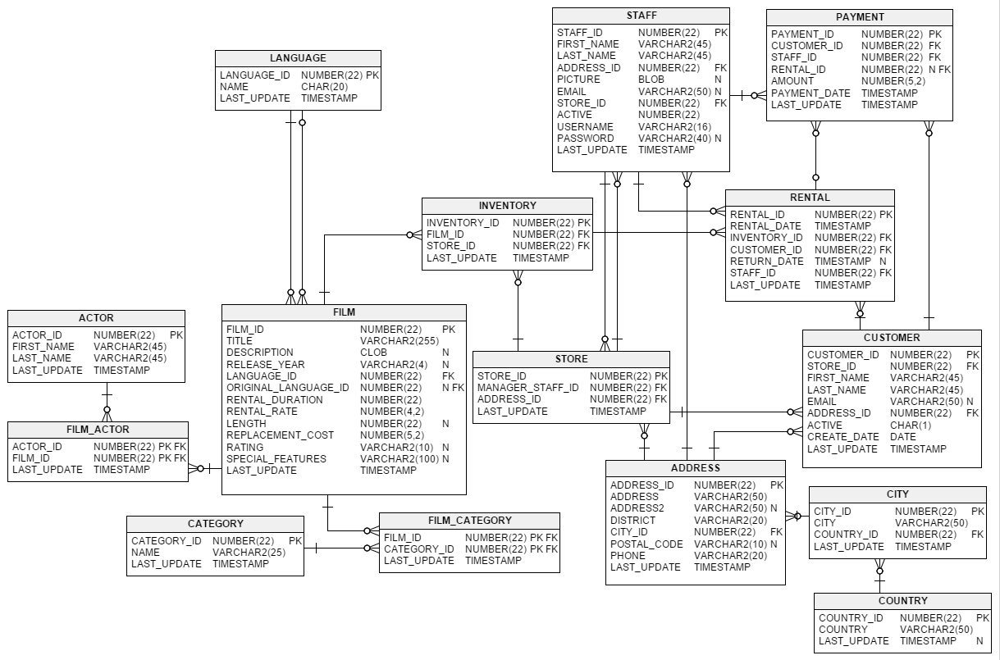

# Database

By default, the project uses in-memory repositories (simple key-value map implementations), so you do not need
to connect a database to the backend.

## Run the project with PostgreSQL

1. Start a new PostgreSQL database as an OCI/Docker container:

   ```
   docker run --name postgres-alpstein -e POSTGRES_PASSWORD=password -p 5432:5432 postgres:16-alpine
   ```

2. Set up the database schema with [Flyway](https://github.com/flyway/flyway). There are two
   alternatives. Pick **one** of them per database; they cannot be combined (see
   [below](#what-the-migrations-contain)).

   For the shipped Sakila example — the vertical slice tables plus the Sakila schema and its data:

   ```
   ./gradlew :database:postgresql-sakila-db-dump:flywayMigrate
   ```

   For the generated schema only — the vertical slice tables plus the tables generated from the
   essential data model, without any data. This is what a domain of your own needs:

   ```
   ./gradlew :database:postgresql-dsl-schema:flywayMigrate
   ```

3. Start the server with the Spring Boot profile `postgres` (= `application-postgres.properties`):

   ```
   ./gradlew :server:app:bootRun --args='--spring.profiles.active=postgres'
   ```

## What the migrations contain

* **`database:postgresql-dsl-schema`** — the Flyway migrations for the application's own schema:
  `db/migration` holds the handwritten migrations of the vertical slice, `db/generated-migration`
  the ones generated from the essential data model.
* **`database:postgresql-sakila-db-dump`** — the reference [Sakila](https://www.jooq.org/sakila)
  DVD-rental schema and its data, loaded as Flyway migrations into the same schema, so the shipped
  application has real example data to run against. This task also includes the handwritten
  migrations of `postgresql-dsl-schema`, so it alone yields a complete database.

Both tasks record what they applied in the same `flyway_schema_history` table, and each one
validates that table against its own migrations before it migrates. Running the second task on a
database set up by the first therefore fails with "Detected applied migration not resolved
locally". Use one task per database.



## Flyway migration with custom PostgreSQL parameters (optional)

By default, Flyway connects to `jdbc:postgresql://localhost:5432/postgres`. To connect to a different database, use
`-Pflyway.url`, `-Pflyway.user` and `-Pflyway.password`, or the `FLYWAY_URL`, `FLYWAY_USER` and
`FLYWAY_PASSWORD` environment variables. Both Flyway tasks accept the same parameters:

```
./gradlew :database:postgresql-dsl-schema:flywayMigrate -Pflyway.url=jdbc:postgresql://localhost:5432/alpstein
```

## Spring Boot with custom PostgreSQL parameters (optional)

To run Spring Boot with custom PostgreSQL parameters, adapt the properties in
`server/app/src/main/resources/application-postgres.properties` to your needs:

```
spring.datasource.url=...
spring.datasource.username=...
spring.datasource.password=...

```
or pass them on the command line:

```
./gradlew :server:app:bootRun --args='--spring.datasource.url=... --spring.datasource.username=...'
```

