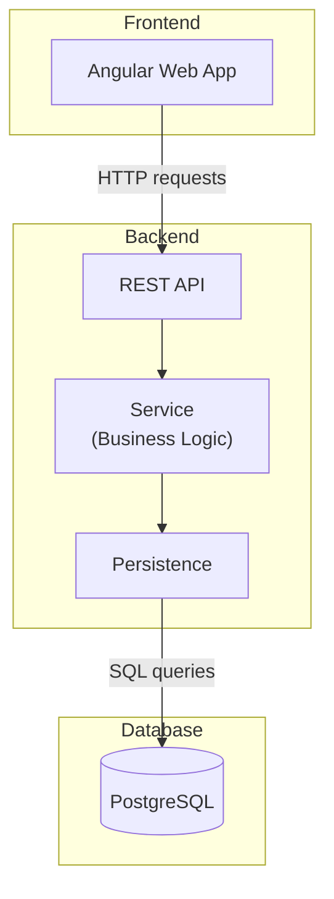

# Web Application Stack

Alpstein is a three-tier web application — an **Angular** client, a **Spring Boot** (Kotlin)
server, and a **PostgreSQL** database. Most of the modules below hold the handwritten vertical
slice next to the code generated from it (see [building-blocks.md](building-blocks.md)).

| Framework   | Layer       | Description                                                                                                                                                                                                                                   | Gradle projects                                                  |
|-------------|-------------|-----------------------------------------------------------------------------------------------------------------------------------------------------------------------------------------------------------------------------------------------|------------------------------------------------------------------|
| Angular     | Frontend    | the UI: a search board, result table, editor form, reference picker and delete dialog per item; built and run with `npm`                                                                                                                                                                                                                    | `client`                                                         |
| Spring Boot | REST        | REST controllers and web transfer objects (WTOs), exposed as an OpenAPI document (springdoc) that the client is built against.                                                                                                                | `server:rest`                                                    |
| Spring Boot | Service     | the business layer: services, repository interfaces, and business objects (BOs). Framework-agnostic; both `server:rest` and `server:persistence` depend on it.                                                                                | `server:service`                                                 |
| Spring Boot | Persistence | repository implementations: one `InMemory*Repository` per item plus a `PostgresSql*Repository` variant that talks to the database over JDBC. The default Spring Boot profile (`application.properties`) uses the in-memory repositories. | `server:persistence`                                             |
| PostgreSQL  | Persistence | The Spring Boot profile `postgres` (`application-postgres.properties`) targets the PostgreSQL database. See [database](./database.md).                                                                                                         | `database:postgresql-dsl-schema`, `database:postgresql-sakila-db-dump`     |

**`server:app`** is the runnable Spring Boot application. It wires the four modules above together, serves a small static welcome page and can optionally serve the built Angular client.

## Random Example Data
On startup, **`server:example-data`** uses Datafaker to generate artificial example data for each item and fills the repositories with it. This is especially useful for the in-memory repositories.

| Property                                                                    | Description                                                                                                                                                                                                                                                                                                                    | `application.properties` | `application-postgres.properties`                        |
|-----------------------------------------------------------------------------|--------------------------------------------------------------------------------------------------------------------------------------------------------------------------------------------------------------------------------------------------------------------------------------------------------------------------------|--------------------------|----------------------------------------------------------|
| `org.codeblessing.alpstein.exampledata.createRandomData`                     | Whether random example data is created and persisted on startup for the [vertical slice entities](building-block-1-the-vertical-slice.md). With `false`, no example data is created at all.                                                                                                                                 | `true`                   | `true`                                                   |
| `org.codeblessing.alpstein.exampledata.createRandomData.forGeneratedItems`   | Also create random example data for the generated items of the [essential data model](building-block-2-the-essential-data-model.md) that have a primary key. Requires `createRandomData=true`. | `true`                   | `false` (because the sakila database provides real data) |

